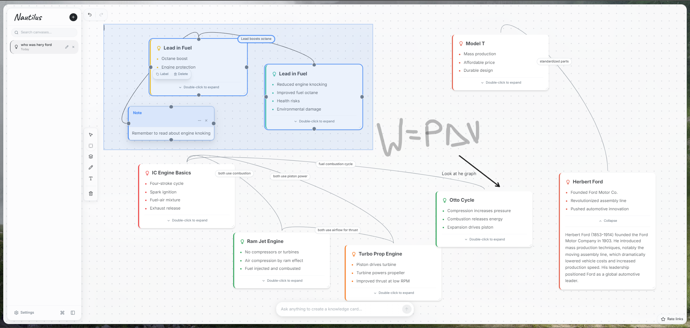
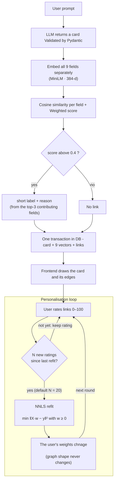
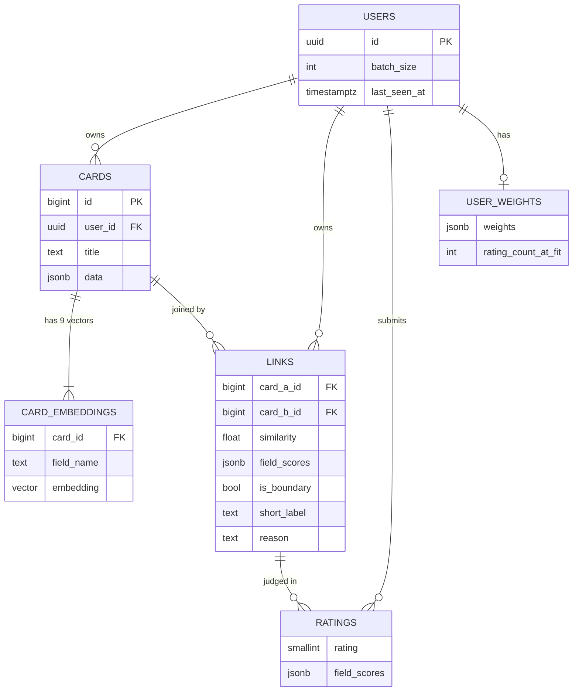

<div align="center">

# Nautilus

**Nautilus turns every AI answer into a card on an infinite canvas, then automatically links it to the ideas it truly resembles and explains why.**

<br/>

[](https://nautilus-us.duckdns.org)


[**What is it?**](#what-is-nautilus) · [**How it works**](#-how-it-works) · [**The Tech**](#the-tech) · [**Design Choices**](#backend-design-choices) · [**Frontend**](#frontend) · [**Future Scope**](#future-scope) · [**Contributors**](#who-made-it) 

</div>

---


## What is Nautilus?

Chat-based AI is **linear**. You ask, it answers, the answer scrolls away, and three prompts later you've forgotten how today's question connects to the one from an hour ago. The connections between ideas live only in your head.

**Nautilus replaces the chat thread with a canvas.**

- Every prompt creates **one independent Card** — a short title, a punchy summary, and a deeper explanation you open with a double-click. It is *not* a continued conversation.
- The system continuously compares every new Card against the Cards already on your canvas.
- When two concepts are genuinely related, Nautilus draws a **Link** between them, labels it in a few words, and writes a short explanation of *why* and *how* they connect.
- Over time you get a **non-linear, evolving knowledge graph** that you can explore, rearrange and reason about spatially instead of sequentially.

> **Terminology** &nbsp;·&nbsp; **Card** = the information about one topic. &nbsp;**Link** = a labelled, explained connection between two Cards.

```text
╭─────────────────╮                             ╭─────────────────╮
│                 │                             │                 │
│                 │       ╭────────────╮        │                 │
│      Card A     │───────│    Link    │───────►│      Card B     │
│                 │       ╰────────────╯        │                 │
│                 │                             │                 │
╰─────────────────╯                             ╰─────────────────╯
```

### The idea that makes it different

Most "related content" features match on *words* or on a single blended embedding of the whole text. Nautilus asks a harder question: **do these two concepts work the same way?**

> 

To do that, every Card is broken into **nine separate fields** (core principles, mechanism, formal structure, applications, …), each embedded on its own and weighted by how much it should matter. Then the weights **learn from you**: rate a few links, and Nautilus refits its own similarity function to your sense of what "related" means.
<br/>
<br/>

<span style="font-size: 30px;">A typical session</span>
<div align="center">

|  | You | Nautilus |
|:-:|-----|----------|
| 1 | Type a prompt | Generates a Card: short title + summary points |
| 2 | Double-click the Card | It expands into a detailed explanation |
| 3 | Type another prompt | A *new* Card appears (never extends the old one) |
| 4 | <span style="font-size: 25px;">↔</span>  | If the two are related, a labelled Link is drawn between them |
| 5 | Click the Link | The explanation of *why* they connect opens |
| 6 | Rate the Link (0–100) | After enough ratings, your personal weights update |
</div>

<br/>

---

## Screenshots


<div align="center">



*A canvas of knowledge cards, auto-linked by concept similarity*

</div>

<br/>


---

## How it works

Everything starts with a single endpoint, `POST /generate-card`. Here is the full journey of one prompt:



### A card has nine fields, not one blob

The LLM returns a card with the text shown to the user (title, summary, bullets, details) **+ nine "linking fields"** that exist purely for comparison. Each field is embedded on its own, and each carries a different weight in the final score:

<div align="center">

| Field | Default weight | What it captures |
|-------|:-------------:|------------------|
| `corePrinciples` | **0.25** | The underlying mathematical / physical principles |
| `mechanism` | **0.25** | The causal chain     *A → B → C* |
| `formalStructure` | **0.15** | The abstract mathematical shape (feedback loop, exponential decay, threshold effect…) |
| `problemPatterns` | 0.10 | The general problem-solving pattern it belongs to |
| `applications` | 0.10 | Where the idea is used |
| `constraints` | 0.05 | Its limits and boundary conditions |
| `examples` | 0.04 | Closest, most widespread examples |
| `misconceptions` | 0.03 | Common mistakes people make about it |
| `analogy` | 0.03 | The intuitive mental model |

</div>

### Scoring

```
score(A, B)  =  Σ  wᵢ · cos( Aᵢ , Bᵢ )          
```

- **Link threshold:** `0.4` — only pairs scoring above it become links. (and only then is the LLM called)
- **Boundary band:** `0.4 – 0.55` — links in this band are flagged `is_boundary`: they're just strong enough to count as links, but not confidently, so the rating toast prompts the user to rate them.

### "Learning" Using NNLS 

Every link can be rated **0–100**. Each rating is stored together with the default of that pair's field scores. Once a user has submitted *N* new ratings (default **20**, adjustable in Settings), the backend solves:

```
minimise  ‖ X·w − y ‖²         w ≥ 0

X : one row per rating  
y : the ratings, scaled between 0–1
w : the visitor's personal field weights
```

Using `scipy.optimize.nnls`. The result is that visitor's own set of weights, and `GET /links` returns every link re-scored with them (`user_similarity`). Rating the links Nautilus was *least sure about* makes it more eficent.

---

## The Tech

### Core stack

| Layer | Technology | Used for |
|-------|------------|----------|
|  **Embeddings** | `sentence-transformers` · `all-MiniLM-L6-v2` (384-d) · PyTorch | One normalised vector per card field, computed locally (uses a GPU automatically if available) |
|  **Personalisation** | SciPy · NumPy | Weighted cosine scoring and non-negative least squares (`scipy.optimize.nnls`) to learn each visitor's field weights |
| **Backend** | Python 3.12 · FastAPI · Uvicorn · Pydantic | REST API, request validation, per-visitor orchestration |
|  **Database** | PostgreSQL 16 · `pgvector` · `psycopg` 3 (connection pool) | Cards (JSONB), 384-d vectors, links, ratings, learned weights |
|  **Frontend** | React 18 · TypeScript · Vite 5 · Tailwind CSS · shadcn/ui · `@xyflow/react` | The canvas, nodes, edges and UI |

###  Demo deployment (`demo` branch)

| Layer | Technology | Used for |
|-------|------------|----------|
|  **LLM** | Groq API · `openai/gpt-oss-20b` | Fast response for card and link content |
|  **Proxy / TLS** | Caddy 2 | Serves the built SPA, proxies `/api`, automatic HTTPS |
|  **Containers** | Docker · Docker Compose | Three services: `db`, `backend`, `web` |
|  **Hosting** | Google Compute Engine (e2-medium) | One-VM production stack |
|  **CPU-only build** | CPU-only PyTorch  | Lesser cost at small scale|

---


##  Backend Design Choices

The backend is where most of the thinking went. These are the decisions that shape it, and *why* each one was made.

### 1. Nine vectors per card instead of one
A single embedding of a whole card blends everything together a shared *example* looks the same as a shared *mechanism*. Embedding each field separately lets the system say **"these two match on mechanism and formal structure, but not on applications"**, which is precisely what makes the link explainable and the weights learnable.

### 2. A weighted *linear* score
The final score is a weighted sum of per-field cosines. Keeping it linear is better (you can read off why two cards matched) also is cheap to compute.

### 3. The LLM is the last step
Cheap vector maths decides *whether* two cards are related then only is LLM called for pairs that cross the `0.4` threshold, and only to *explain* a connection that already exists. That keeps latency and API cost down, and means the model never invents a link. If the explanation call fails, the link still ships with a fallback label built from the matching field names thus **a bad LLM response never blocks card creation.**

### 4. Local embeddings, baked into the image
Embeddings run in-process with `all-MiniLM-L6-v2`- 384 dimensions, and fast enough on a CPU-only if no GPU CUDA.

### 5. NNLS for personalisation 
- **Non-negative** -  A weight can only say "this field matters more or less", never "its *opposite* matters", so the learned weights stay readable.

### 6. Ask for the ratings that teach the most
Not every rating is equally valuable. Links scoring close to the threshold are the ones the default weights are least sure about, so those are flagged (`is_boundary`) and `GET /links/candidates` serves unrated links ordered by distance from the threshold. It's a small dose of **active learning** fewer ratings needed for a better fit.


### 7. Fundamentals

<br/>

| Area | What's in place |
|------|-----------------|
| **Storage** | PostgreSQL + pgvector: card payloads as `JSONB`, the nine vectors in a normalised `vector(384)` table. Started on flat JSON files and moved to Postgres ahead of going public. Cosine scoring runs in NumPy, since each comparison combines nine similarities with per-visitor weights |
| **Integrity** | Canonical link ordering (`CHECK (card_a_id < card_b_id)` + `UNIQUE`). Ratings keep their own snapshot of the field scores and survive card deletion, because they're training data. Clearing a canvas keeps learned weights and settings |
| **Security** | Least-privilege roles- an owner that runs migrations, and `nautilus_app`, which can't create, alter or drop anything. Migrations are SHA-256 checksummed and guarded by an advisory lock |
| **Concurrency** | LLM and embedding work run outside any database transaction, then one atomic write stores the card, its nine vectors and its links. A per-visitor lock prevents racing generations, so the backend runs a single Uvicorn worker on purpose |
| **Isolation** | Each browser gets a random UUID (`X-Visitor-Id`) and every query is scoped to it. It identifies a browser but doesn't authenticate it, a deliberate trade for a zero-signup demo, with real auth on the roadmap |


---

## Database



---

## API Reference

| Method | Endpoint | What it does |
|:------:|----------|--------------|
| `POST` | `/generate-card` | Prompt → card → embeddings → links, all in one call |
| `GET` | `/cards` | All of the visitor's cards |
| `GET` | `/card/{id}` | One card |
| `DELETE` | `/card/{id}` | Delete a card (and its links, vectors) |
| `DELETE` | `/canvas` | Clear cards and ratings; keep weights and settings |
| `GET` | `/links` | All links, re-scored with the visitor's personal weights (`user_similarity`) |
| `GET` | `/links/candidates` | Unrated links, most uncertain first |
| `POST` | `/rating` | Submit a 0–100 rating; may trigger a refit |
| `GET` | `/weights` | Current weights, rating count, ratings until next refit |
| `GET` / `PUT` | `/settings` | Read / change the refit batch size |
| `GET` | `/ping` | Health check (also verifies the database) |

---

## Frontend

> **The frontend was built by [Thanas R](https://github.com/Thanas-R).**
> The look was designed together *BUT* the code the canvas, the nodes, the edges, and their designs the interactions is his work, and most of what you **see** in Nautilus is all him. 

**Stack:** React 18 · TypeScript · Vite 5 · Tailwind CSS · shadcn/ui (Radix) · `@xyflow/react` v12 · Framer Motion · TanStack Query · React Router · react-markdown + Mermaid · perfect-freehand + roughjs

A quick tour of how it holds together:

**Routing.** The app is a single-page workspace. React Router has just two routes — `/` renders the workspace and `*` renders a 404 — because the real "navigation" happens *inside* the canvas. Production serves it with an SPA fallback (unknown paths → `index.html`), so deep links never 404 at the server.

**Node routing.** Every node on the canvas has a `type` string, and a registry maps that string to the React component that draws it:

**Link routing.** When `/generate-card` returns, the frontend builds a `backendId → nodeId` map of what's on the current canvas and turns each returned link into an edge , but only if the card on the other end is actually on this canvas. Each edge is a custom bezier edge that carries its label, explanation, confidence and link id. Nodes expose four-sided connection handles, and when several edges join the same pair of nodes a small hook (`useEdgeParallelism`) groups them and fans the curves and labels apart so they never stack on top of each other.

**State & persistence.** One React-context store (`CanvasStoreProvider`) owns nodes, edges and every canvas action. The *knowledge* (cards, links, ratings, weights) lives in Postgres; the *layout* (positions, edges, your list of canvases, theme) is saved per canvas in the browser's `localStorage` with a debounced auto-save and flushed on switch and unload. The visitor ID lives there too.


##  Project Structure

```text
Nautilus/
├── backend/
│   ├── main.py            # FastAPI app: endpoints, per-visitor locks, link generation
│   ├── llm.py             # Groq client: card generation + link explanations
│   ├── embedding.py       # MiniLM embeddings, field weights, cosine scoring
│   ├── calibration.py     # NNLS personalisation
│   ├── database.py        # Connection pool + every SQL query
│   ├── validation.py      # Pydantic schemas
│   ├── migrate.py         # Checksummed migration runner + least-privilege role
│   └── migrations/        # 0001_extension · 0002_core_tables · 0003_grants
├── frontend/
│   ├── src/pages/                 # Index · NotFound
│   ├── src/components/canvas/     # KnowledgeCanvas, nodes/, edges/, drawing, rating UI
│   ├── src/hooks/                 # useCanvasStore, useChatHistory, undo/redo, edge parallelism
│   ├── src/lib/api.ts             # Typed client for the backend
│   └── Caddyfile                  # Reverse proxy + SPA fallback
├── docker-compose.yml             # Local development stack
├── docker-compose.prod.yml        # Production stack for the VM
├── DEPLOY.md                      # VM deployment notes
└── .env.example
```

---

## Future Scope

### Backend

- [ ] **Scale the search.** Scoring is currently O(n) over a visitor's cards in NumPy move candidate retrieval into pgvector with **HNSW indexes** once graphs get large
- [ ] **A re-ranking stage.** Use a cross-encoder to re-rank only the top candidates as too slow to be the main filter, ideal as a second opinion.
- [ ] **Contrastive fine-tuning.** Fine-tune the embedding model on users' labelled link pairs, so the vectors themselves learn what "related" means
- [ ] **Calibration validation harness.** Automated checks that learned weights stay non-negative, don't collapse onto one dominant field, move in intuitive directions, and never change topology
- [ ] **Async generation.** Move LLM calls to a background queue and stream card progress to the UI instead of blocking the request

### Frontend

- [ ] **Cross-canvas links.** The backend already scores a card against *all* of a visitor's cards
- [ ] **Similarity-based smart layout.** Cards arrange themselves by meaning: related cards cluster together, and the more similar two cards are, the closer they sit. Links are drawn dynamically, both inside a cluster and between clusters, but only on demand- an edge appears when similarity is more than adjustable threshold, so dense graphs stay readable.
- [ ] **See your weights.** A visual panel (radar chart) showing how your personal weights differ from the defaults
- [ ] **Search, minimap and clustering** for large canvases
- [ ] **Touch and mobile polish**, plus full keyboard accessibility
- [ ] **Collaborative canvases** shared between people in real time


---
## Who made it?

<div align="center">


<table>
  <tr>
    <td align="center" width="260">
      <a href="https://github.com/Tanay-s5">
        
      </a>
      <br/><br/>
      <b><a href="https://github.com/Tanay-s5">Tanay S</a></b>
      <br/>
      <sub>💡 Concept and Backend</sub>
    </td>
    <td align="center" width="260">
      <a href="https://github.com/Thanas-R">
        
      </a>
      <br/><br/>
      <b><a href="https://github.com/Thanas-R">Thanas R</a></b>
      <br/>
      <sub>🖥️ Frontend and Design</sub>
    </td>
  </tr>
</table>


</div>

<div align="center">
<br/>
That was a long read , thanks for your time :D

</div>
